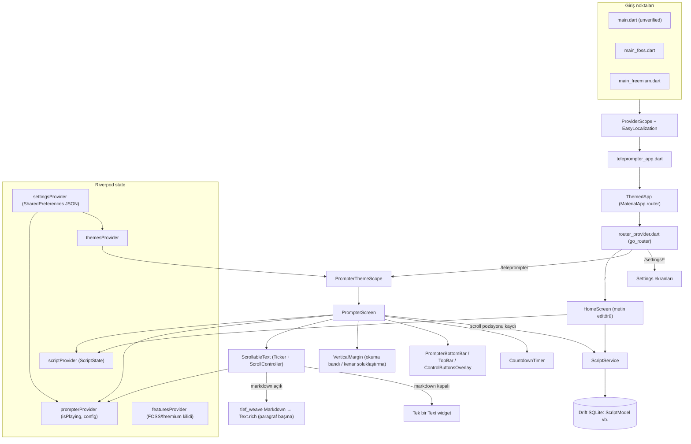

# Mimari Analiz Raporu (tarihi, ilk fork analizi)

> Bu rapor, projenin ilk analiz aşamasında (hiçbir dosya değiştirilmeden) hazırlanmıştır.
> Ürün kimliği o tarihten sonra CueLine (`app.cueline.teleprompter`) olarak değişti; aşağıdaki metin TiefPrompt fork’unun başlangıç durumunu belgeler.

## Özet

Proje, TiefPrompt'un neredeyse değiştirilmemiş hâlidir (git'te tek bir "Initial commit" var). Mimari temiz ve katmanlıdır; ancak metin tek parça bir `String` olarak tutulmaktadır ve kelime düzeyinde hiçbir yapı yoktur. Projede mikrofon veya speech-to-text ile ilgili hiçbir dependency ya da izin bulunmamaktadır. Karaoke ve sesle takip için en kritik iş, metni kelimelere bölen bir model ve buna uygun kendi metin render'ını yazmaktır.

## Mimari harita

## 1. Mevcut mimari

- **Framework ve state yönetimi:** Flutter, Riverpod 3 (codegen ile, `@riverpod`) ve freezed. Ekran geçişleri `go_router` ile yapılıyor.
- **Kalıcı veri:** Metinler Drift (SQLite) veritabanında, ayarlar `shared_preferences` içinde tek bir JSON (`settings_json`) olarak tutuluyor.
- **Çoklu dil:** `easy_localization`; çeviriler `assets/translations/` altında.
- **Loglama:** `talker` ve `talker_riverpod_logger`.
- **Flavor yapısı:** Üç giriş noktası var. Aralarındaki tek fark `featuresProvider` override'ı. `main.dart` "unverified", `main_foss.dart` tüm özellikleri açık, `main_freemium.dart` uygulama içi satın almaya göre kilitli sürüm.
- **Özellik kilitleme:** Butonlar ve kısayollar `Feature` enum'una bakıyor (`lib/core/constants.dart`). Yeni bir özellik (örneğin sesle takip) bu enum'a ve `kAllFeatures` listesine eklenmezse kilitli kalır.
- **Platformlar:** Android, iOS, macOS, Linux ve Windows klasörleri mevcut.

## 2. Ana dosyalar ve görevleri

| Dosya | Görev |
|---|---|
| `lib/main*.dart` | Başlatma ve flavor'a göre provider override'ları |
| `lib/teleprompter_app.dart` | Açılışta özellik kontrolleri ve "ephemeral" (geçici) metnin DB'den yüklenmesi |
| `lib/providers/router_provider.dart` | Tüm route'lar |
| `lib/ui/screens/home_screen.dart` | Ana ekran: başlık ve metin `TextField`'ları, Start / Select / Save |
| `lib/ui/screens/prompter_screen.dart` | Teleprompter ekranı: overlay'ler, kısayollar, wakelock, yön kilidi, scroll pozisyonu kaydı |
| `lib/ui/widgets/scrollable_text.dart` | Metnin gösterilmesi ve otomatik kaydırma motoru |
| `lib/ui/widgets/vertical_margin.dart` | Okuma göstergesi ve üst/alt kenar kutuları |
| `lib/ui/widgets/prompter_bottom_bar.dart` | Oynat/duraklat, hız, font ve görünüm panelleri |
| `lib/providers/prompter_provider.dart` | Çalışma anı state'i: `isPlaying`, `displayCountdown`, `config` |
| `lib/providers/prompter_config.dart` | Hız, font, kenar boşluğu, ayna, markdown gibi görüntü ayarları |
| `lib/providers/settings_provider.dart` | Ayarların kalıcı tutulması (renkler, tema, config) |
| `lib/providers/theme_provider.dart` | Uygulama temaları ve ayrı bir `prompterTheme` |
| `lib/providers/script_provider.dart` | Bellekteki aktif metin (`ScriptState`) |
| `lib/models/script_model.dart`, `lib/models/database.dart` | Drift tablosu ve migration'lar (şema v7) |
| `lib/services/script_service.dart` | Metin CRUD ve scroll pozisyonu kaydı |

## 3. Mevcut scrolling sistemi

- Kaydırma `ScrollableText` içindeki bir `Ticker` ile, her karede `jumpTo` çağrılarak yapılıyor. Hız "saniyede satır" cinsinden ve `fontSize * height` ile piksele çevriliyor.
- `ref.listen(prompterProvider.select(isPlaying, scrollSpeed))` ile Ticker başlatılıp durduruluyor. Geri sayım `Prompter.togglePlayPause()` içindeki bir `Timer` ile yönetiliyor.
- Kullanıcı parmakla sürüklerken `_userScrollingProvider` true oluyor ve ticker kaydırmıyor.
- `ScrollableTextController` yalnızca `jumpTo` ve `jumpRelative` sunuyor; klavye kısayolları bunu kullanıyor.
- `SingleChildScrollView` üst boşluğu ekran yüksekliği kadar; altta "The End" kutusu var. Açılışta kayıtlı pozisyona ya da ekranın yarısına atlanıyor.
- Scroll pozisyonu debouncer ile önce `scriptProvider`'a, sonra DB'ye yazılıyor.
- `VerticalMargin` üstte ve altta yarı saydam kutular çiziyor; aradaki boşluk okuma alanı.
- `PrompterScreen` ekranı zorla yatay yapıyor ve `leanBack` moduna alıyor; mobil/dikey MVP için değişmeli.

## 4. Metin render sistemi

- **Veri modeli:** DB'de `ScriptModel` (`id, title, scriptText, createdAt, ephemeral, scrollPosition`), bellekte `ScriptState`. Metin düz bir `String`.
- **Markdown kapalıyken:** Tüm metin tek bir `Text` olarak çiziliyor.
- **Markdown açıkken:** Dış paket `tief_weave` (0.4.0). Metin `Paragraph`, `Heading`, `Hrule` bloklarına ayrılıyor; her blok `RepaintBoundary` içinde ayrı bir `Text.rich`. Satır içi biçimler (italik, kalın, altı çizili) birer `TextSpan`. `MarkdownRendererController.offsetOf(blockIndex)` blok konumlarını veriyor (bölüm başlığı banner'ı bunu kullanıyor).
- **Stil ve renk:** Font boyutu/ailesi `PrompterConfiguration`'dan; renk `PrompterThemeScope` üzerinden `settings.prompterTextColor`'a bağlı `colorScheme.onSurface`'ten geliyor. Renk tüm metin için tek; kelime bazında stil yok.
- **Kısıtlar:** `tief_weave` pub cache'ten geliyor, projeden değiştirilemez. Markdown iki kez parse ediliyor (`ScrollableText._rebuildAst` ve `Markdown` widget'ı).

## 5. Speech-to-text eklemek için uygun nokta

- **Mevcut durum:** `pubspec.yaml`/`pubspec.lock` içinde speech/record/audio/permission paketi yok. Ana `AndroidManifest.xml`'de hiç `uses-permission` yok (`INTERNET` yalnızca debug/profile'da). iOS `Info.plist`'te mikrofon/konuşma tanıma açıklamaları yok.
- **Önerilen katmanlar:**
  - `lib/services/` altında ses tanıma servisi (başlat/durdur, partial sonuç akışı, sessizlik sonrası otomatik yeniden başlatma).
  - `lib/providers/` altında takip state'i (aktif kelime indeksi, güven, dinleme durumu).
  - Flutter'dan bağımsız, saf Dart eşleştirme motoru (unit test edilebilir).
  - `PrompterScreen` dinlemeyi yaşam döngüsüne göre açıp kapatır; `ScrollableText`'e aktif kelime verilir.
  - `PrompterState`'e mod alanı (sabit hız / sesle takip).
- **Paket önerisi:** Android MVP için `speech_to_text` + `permission_handler`. Android oturumu sessizlikte kapanır (yeniden başlatma döngüsü gerekir), Türkçe için `tr_TR`. Çevrimdışı alternatif olarak Vosk.

## 6. Karaoke highlighting için uygun yaklaşım

1. **Metin modeli:** Paragraflar ve kelimeler; her kelime için global indeks, karakter aralığı, markdown stili. Türkçe'ye özgü küçük harf normalizasyonu (İ→i, I→ı), noktalama atılır.
2. **Eşleştirme:** Mevcut konum etrafında pencere (örn. −5/+30 kelime); tanınan son 3–6 kelime bulanık eşleştirmeyle aranır; eşik üstü en iyi aday kabul edilir; düşük güvende pencere genişletilerek yeniden senkronizasyon.
3. **Render:** Paragraf başına bir `Text.rich`, kelime başına bir `TextSpan`; okunmuş soluk, aktif vurgulu. `RepaintBoundary` korunur, yalnızca aktif paragraf yeniden çizilir.
4. **Kaydırma:** Aktif kelimenin konumu `RenderParagraph.getBoxesForSelection` ile bulunur, okuma bandına `animateTo` ile hizalanır.

## 7. Değiştirilmesi gereken dosyalar

**Mevcut dosyalar:**
- `pubspec.yaml`: STT ve izin paketleri; uygulama adı.
- `android/app/src/main/AndroidManifest.xml`: `RECORD_AUDIO`, `<queries>` içine `android.speech.RecognitionService`, `android:label`.
- `android/app/build.gradle`: `applicationId`/`namespace` (`MainActivity.kt` paket yolu ile birlikte).
- `lib/ui/widgets/scrollable_text.dart`: karaoke renderer'ı ve hedef konuma kaydırma.
- `lib/ui/screens/prompter_screen.dart`: STT yaşam döngüsü, yön kilidi, overlay'ler.
- `lib/providers/prompter_provider.dart`, `prompter_config.dart`, `settings_provider.dart`: mod, dil, vurgu renkleri.
- `lib/core/constants.dart`: yeni `Feature` değeri.
- `lib/ui/widgets/prompter_bottom_bar.dart`, `prompter_control_buttons_overlay.dart`: mikrofon butonu.
- `lib/ui/screens/home_screen.dart`, `lib/providers/theme_provider.dart`: modern arayüz.
- `assets/translations/*`: yeni metinler ve Türkçe.

**iOS (ileride):**
- `ios/Runner/Info.plist`: `NSMicrophoneUsageDescription`, `NSSpeechRecognitionUsageDescription`, `CFBundleDisplayName`.
- `ios/Runner.xcodeproj/project.pbxproj`: bundle ID (deployment target 15.6 yeterli).
- iOS projesi CocoaPods yerine Swift Package Manager kullanıyor; STT paketinin SwiftPM desteği doğrulanmalı.

**Riskler:** AGP 9.2 / Kotlin 2.4 / Gradle 9.6 ile plugin uyumluluğu; `integration_test/` harness'larının kırılması; MIT lisans atfının korunması.

## 8. Android MVP geliştirme sırası

1. Temizlik ve kimlik (ad, `applicationId`, tek flavor, dikey yön).
2. Kelime modeli ve tokenizer (saf Dart, testli).
3. `KaraokeText` renderer'ı (önce elle/debug ile kelime ilerletme).
4. Mikrofon izni ve STT servisi.
5. Eşleştirici (pencereli bulanık eşleştirme, yeniden senkronizasyon).
6. Entegrasyon (aktif kelime + yumuşak kaydırma, mod geçişi).
7. Modern arayüz.
8. Sağlamlaştırma (performans, cihaz farkları, yaşam döngüsü).
9. iOS uyarlaması ve gerekirse çevrimdışı STT.
